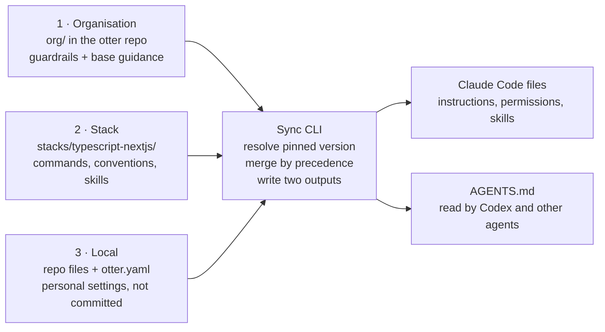

# Otter — AI Development Harness Plan

Oct 11, 2026 · Anthony Crowcroft (harness lead)

## Summary

We will build Otter, one harness that Claude Code and Codex run inside, assembled from three layers: **organisation**, **stack** and **local**. The organisation and stack layers live as folders in one `otter` repo; each product repo pins a harness version and adds its own local layer.

- **Organisation** sets the non-negotiables: security policy, approved tools and MCP servers, permission defaults, and shared engineering principles.
- **Stack** adds what is true for one technology, meaning a language plus its frameworks (we start with TypeScript and Next.js): commands, conventions, patterns, skills and evals.
- **Local** adds what is true for one repo or one developer: architecture, domain language, runbooks and personal preferences.

Guardrails flow down and cannot be loosened; guidance flows up and the most specific layer wins. Sized for a team of under five working part-time, the harness runs on two pilot repos by week 4 and on every active TypeScript/Next.js repo by week 6. Success is judged on quality: AI-assisted PRs merged without major rework.

Rollout is phased — see `phases/` for each phase's weeks, deliverables and gate, starting with `phases/phase-0-decide.md` for the decisions already agreed.

## Design principles

1. **Guardrails versus guidance.** Every rule is tagged as one or the other. Guardrails (no secrets in prompts, no production credentials, approved tools only) are enforced by tooling. Guidance (style, patterns, preferences) is advice the agent reads.
2. **Inherit, don't copy.** A repo declares which harness version it uses; it never pastes the contents. Fixes made once reach every repo on the next sync.
3. **Open formats first.** We author in AGENTS.md and skill conventions that the tools already read. A thin script adds only what Claude Code needs beyond that, so adding another agent later is cheap.
4. **Config as code.** All three layers live in Git, change by pull request, and carry versions and a changelog.
5. **Small and specific beats long and generic.** Each layer keeps its always-loaded instructions short and moves detail into on-demand skills.
6. **Measured, not assumed.** Every harness change runs the eval suite before release.
7. **Only as much process as five people need.** Decisions happen in a pull request or an existing team meeting, not in new ceremonies.

## Layer 1 — Organisation

The organisation layer is the floor every agent stands on: what is allowed and the principles all code must meet. It lives in the `org/` folder of the `otter` repo. The harness lead approves guardrail changes; any working-group member can approve guidance changes.

| Component | What it contains | Type | Enforced by |
| --- | --- | --- | --- |
| Security policy | What code and data may go to a model, secret handling, and the rule that every subscription must have no-training terms | Guardrail | Secret scanning in pre-commit and CI; subscription check at onboarding |
| Tool and MCP allowlist | Claude Code, Codex, and approved MCP servers with pinned versions | Guardrail | Claude Code managed settings; CI check of committed config |
| Permission defaults | Deny production credentials, destructive commands and unapproved network access; list what needs approval | Guardrail | Claude Code permission settings; Codex sandbox and approval settings |
| CI reviewer rules | CI agents can read and comment on PRs, never push, approve or merge | Guardrail | CI token scopes |
| Engineering principles | Commit and PR conventions, testing expectations, licence policy | Guidance | Review; CI lint |
| Shared skills | Writing an ADR, opening a PR, upgrading a dependency, writing up an incident | Guidance | — |
| Usage visibility | Each developer's subscription usage page until Phase 3; a model gateway is considered then | Guidance | — |

## Layer 2 — Stack

The stack layer turns a generic agent into one that builds, tests and structures code the way we do for a given language and framework. Each stack is a folder under `stacks/` in the otter repo, owned by the developer who knows it best. The first is `stacks/typescript-nextjs/`.

Each stack pack contains:

- **Commands** — the exact install, build, lint, type-check and test commands, so the agent verifies its own work the same way CI does.
- **Conventions** — router choice, when to use server or client components, folder layout, data fetching, error handling and logging.
- **Approved libraries** — preferred and banned packages, with the reason for each ban.
- **Skills** — step-by-step recipes for common jobs, such as adding a page or route, an API route or server action, a form with validation, or a UI component.
- **Templates** — a scaffold for a new Next.js app or module that already passes the stack's checks.
- **Reference code** — links to one or two exemplary repos or modules the agent should imitate.
- **Stack guardrails** — tighter rules than the org's where needed, such as never editing generated code or environment files.
- **Eval tasks** — 10–15 representative tasks with known-good outcomes, run headless through Claude Code on every change to the pack.

We add a second stack only when TypeScript/Next.js has passed its pilot gate and a repo on another stack needs it.

## Layer 3 — Local

The local layer gives the agent what only this codebase and this person know. It has two parts with different owners and different rules about what is committed.

| Part | Contents | Owner | Committed? |
| --- | --- | --- | --- |
| Repo | `otter.yaml` manifest pinning org and stack versions; architecture overview and module map; domain glossary; repo-specific commands and environment setup; ADRs; runbooks; areas the agent must not touch | The repo's lead developer | Yes, reviewed like code |
| Developer | Personal preferences (verbosity, language, editor), personal shortcuts and skills, locally installed MCP servers from the allowlist | Each developer | No, kept in the user's home directory and git-ignored |

A new repo gets the repo part from a template: run one command, answer five questions, and the manifest and a starter architecture note are generated. The developer part can only add guidance; it can never relax an org or stack guardrail.

## How the layers compose

A thin sync CLI reads each repo's manifest, pulls the pinned harness version, merges them with the local layer, and writes the files each agent tool expects.



- Guardrails: the strictest layer wins, so org rules can never be relaxed below.
- Guidance: the most specific layer wins, so local overrides stack and stack overrides org.

The CLI is the only thing that writes agent-facing files; the tools never read the otter repo directly.

**The manifest** is the one file a repo team edits to join Otter:

```yaml
otter: v1.0.0
stack: typescript-nextjs
local:
  instructions: docs/agent/
  protected_paths: [generated/, .env*]
tools: [claude-code, codex]
```

**Merge rules**

1. Load org, then the stack, then repo, then developer settings.
2. Guardrails combine as a union and the strictest value wins: a deny anywhere is a deny everywhere.
3. Guidance is layered: a local note on the same topic replaces the stack's, which replaces the org's.
4. Skills from all layers are made available on demand, namespaced by layer to avoid clashes.
5. Two outputs are written: a shared AGENTS.md that Codex and other agents read, and Claude Code's own instruction, permission, skill and MCP files. Features a tool lacks are dropped with a warning, never silently.

Developers run the sync locally after a pin change; CI runs it on every pull request and fails if the committed output differs.

## Verification and governance

The harness is trusted only because every change to it, and every change made through it, is checked automatically before a human approves it.

**Checks on every repo pull request**

- Manifest is valid and pins a released harness version, not a branch.
- Generated agent files match a fresh sync, so nobody hand-edits them.
- Secret scanning, licence and dependency allowlist checks pass.
- The stack's build, lint, type-check and test commands pass.
- A CI reviewer agent comments on the PR; it can't push, approve or merge.
- AI-assisted changes are labelled, and another developer approves them.

**Checks on every harness release**

- The eval suite runs headless through Claude Code against the new version and the current one.
- A release ships only if eval task success does not drop.
- Guardrail changes need the harness lead's approval; guidance changes need any other working-group member.

**Ongoing governance**

- A 20-minute item every fortnight in an existing team meeting covers eval results, rework on AI-assisted PRs, and any incidents.
- Any agent-caused incident gets a short write-up and, where possible, a new guardrail or eval task so it cannot recur silently.

## Roles and ownership

| Role | Who | Owns |
| --- | --- | --- |
| Harness lead | Anthony Crowcroft | The `otter` repo, sync CLI and eval runner; approves guardrail changes |
| Working group | Every developer, part-time | Stack pack contents, skills and eval tasks; reviews harness PRs |
| Repo lead | The lead developer on each repo | That repo's local layer and keeping its pin current |
| Each developer | Everyone | Personal settings, a subscription with no-training terms, reporting gaps and bad agent behaviour |

## Risks and metrics

**Risks**

| Risk | Mitigation |
| --- | --- |
| Instructions grow until they crowd out useful context and agents get worse | Size limit per layer, checked in CI; detail moved into on-demand skills |
| Claude Code features such as hooks and skills have no Codex equivalent | AGENTS.md carries the shared core; Claude Code-only extras are marked optional |
| A personal subscription lacks no-training terms or lapses | Checked at onboarding and each quarter; list kept in the otter repo |
| Part-time effort stalls | One named harness lead; scope held to what fits in six weeks |
| No central usage data until a gateway exists | Judge on PR-level quality metrics; revisit the gateway in Phase 3 |
| Eval suite goes stale and stops catching regressions | Every incident and repeated review comment becomes a new eval task |

**Metrics** (baseline in Phase 0, reviewed fortnightly)

- **Primary, quality:** share of AI-assisted PRs merged without major rework, at or better than baseline.
- Change failure rate on AI-assisted changes, flat or better.
- Eval task success on each harness release.
- Share of active repos pinned to a current harness version.
- Guardrail violations caught, and any that reached main.
